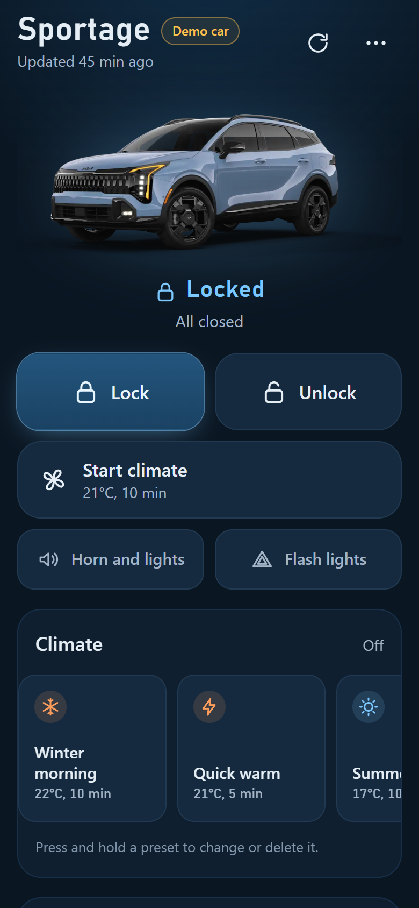

# Car Remote

A fast, private remote for your Kia: lock, unlock, climate with seat and steering-wheel heat,
horn and lights, schedules and presets. It installs on your phone's home screen like an app.
Your car shows up as a real 360° picture of your model in your paint, and the picture turns to
show whichever door, the trunk or the hood is open.



It runs on **your own Windows PC**. The PC talks to Kia, and your phone reaches the PC through a
Cloudflare Tunnel guarded by Cloudflare Access. No third-party server ever sees your Kia password.

> **Unofficial.** This project is not made by, affiliated with or endorsed by Kia. It uses the
> same private API as the official app, through the open-source
> [hyundai_kia_connect_api](https://github.com/Hyundai-Kia-Connect/hyundai_kia_connect_api)
> library. Kia can change that API at any time and break this app. **Kia locks your account
> after a few failed sign-ins**, so if a sign-in fails, stop and check your password at
> kiaconnect.ca before trying again. Use at your own risk.

## Where it works

| Region | Brand | Status |
|---|---|---|
| Canada | Kia | **Tested** on a 2026 Sportage hybrid: every command, the photo and the 360 view |
| Anywhere else | Kia, Hyundai, Genesis | Not yet. The library supports most regions; see [PORTING.md](PORTING.md) to add yours |

Porting is designed to be done with an AI coding assistant: PORTING.md has a prompt you paste in,
plus a safe order for trying things on a real car. Send your region back as a pull request.

## How it works

```
your phone (home-screen app)
   │  HTTPS
   ▼
Cloudflare Access ── "who are you?" one-time code to an allowed email
   │
Cloudflare Tunnel ── outbound from your PC: no open ports, home IP hidden
   │
your Windows PC: Python service on 127.0.0.1:8765
   │  checks the Access token again, asks fingerprint/PIN for unlock,
   │  keeps the Kia session in Windows Credential Manager
   ▼
Kia Connect (the same API the official app uses)
```

What's in it:

- **Dashboard:** lock and unlock, climate with temperature, defrost, steering-wheel and seat
  heat, horn and lights, flash lights, and a forced refresh (rate-limited, because it wakes the
  car). Fuel, range, 12 V battery, doors, windows, tires, warnings and location.
- **The car itself:** your model in your paint, as a 360° turntable from kia.ca. It turns to the
  open door, the trunk or the hood. Drag it to spin it.
- **Climate presets** ("Winter morning", "Quick warm"…) and **schedules** (e.g. warm the car
  at 7:40 on weekdays). The PC sends schedules, so they run even when your phone is off.
- **Approved devices:** a new phone or browser has to enter the Kia account once, even after
  Cloudflare lets it in. You can see and remove approved devices in the menu.
- **Unlock second factor:** Face ID or fingerprint (passkeys), or the Kia PIN.
- **Activity log:** every command, its result, and who sent it.
- **Works like an app:** installs to the home screen, opens instantly from the last known
  state, and recovers by itself after the phone wakes up.

More detail:

- [docs/SETUP.md](docs/SETUP.md): every setup step, including Cloudflare, the PC and Raspberry Pi
  notes.
- [docs/SECURITY.md](docs/SECURITY.md): what protects the car, and what an attacker would need.
- [PORTING.md](PORTING.md): adding your region or brand.
- [docs/api-contract.md](docs/api-contract.md): the JSON API.

## What you need

- A Windows PC that stays on (the service runs at logon and restarts itself).
- Python 3.12 or newer, and Node.js (only for the `npx wrangler` tunnel command).
- A Kia Connect account with the car on it, and its 4-digit PIN.
- For phone access away from home: a domain on Cloudflare (free plan is fine) and Cloudflare
  Zero Trust (free for up to 50 users).

## Set up

### 1. The service on your PC

```powershell
git clone <this repo> kia-remote
cd kia-remote
py -m venv .venv
.venv\Scripts\python.exe -m pip install -r requirements.txt
.venv\Scripts\python.exe -m server --demo     # try it first with a fake car: http://localhost:8765
```

When the demo looks right, stop it (Ctrl+C) and start the real one:

```powershell
.venv\Scripts\python.exe -m server
```

Open http://localhost:8765 and sign in with your Kia Connect email, password and PIN. Kia sends
a one-time code the first time because it sees a new device. After that the saved session is
reused, so restarts don't ask again.

Not sure your account works with this at all? Run `scripts\check_connection.py` first. It only
reads the car's status and saves nothing.

### 2. Reach it from your phone (Cloudflare Tunnel + Access)

The service only listens on the PC itself (127.0.0.1). To use it from your phone:

1. In the Cloudflare dashboard, go to **Zero Trust > Networks > Tunnels** and create a tunnel
   named `kia-remote`. Add a public hostname, for example `car.example.com`, pointing to
   `http://127.0.0.1:8765`.
2. In **Zero Trust > Access > Applications**, add a self-hosted application for
   `car.example.com`, with a policy that allows only your own email (and your family's).
3. Put the two Access values in `%LOCALAPPDATA%\kia-remote\settings.json`:

   ```json
   {
     "access_team_domain": "yourteam.cloudflareaccess.com",
     "access_aud": "the Application Audience (AUD) tag"
   }
   ```

   - `access_team_domain`: shown under Zero Trust > Settings > Custom Pages, or just the team
     name (`yourteam` works too).
   - `access_aud`: Zero Trust > Access > Applications > your application > Overview,
     "Application Audience (AUD) Tag".

   Neither value is a secret.

The service checks the Access token itself, so a misconfigured tunnel still gets nothing. **Until
both values are set, every request through the tunnel is refused** and the log says so loudly. A
browser on the PC itself always works. Each command in the activity log records who sent it.

On the phone, open `https://car.example.com`, sign in through Access, then use **Add to Home
Screen** (Safari's share menu on an iPhone, Chrome's menu on Android). Open the app from the home
screen and approve the device with your Kia email, password and PIN. On an iPhone, the home-screen
app keeps its own storage apart from Safari, so approve it there, not in Safari.

### 3. Start with Windows

```powershell
powershell -ExecutionPolicy Bypass -File scripts\install-startup.ps1
```

This registers a scheduled task that runs `scripts\start.ps1` hidden at logon. That script keeps
both the service and the tunnel (`npx wrangler tunnel run kia-remote`) running, restarting either
one if it stops. Its log is `%LOCALAPPDATA%\kia-remote\start.log`. To remove it:
`Unregister-ScheduledTask -TaskName kia-remote -Confirm:$false`.

## Settings

Everything goes in `%LOCALAPPDATA%\kia-remote\settings.json`. Restart the service after a change.

| Key | Meaning |
|---|---|
| `access_team_domain`, `access_aud` | Cloudflare Access (above) |
| `region` | Which Kia Connect region; default `"canada"`. See PORTING.md |
| `app_name` | The name under the home-screen icon, e.g. `"Sportage"`. Default "Car Remote" |

## Unlock: fingerprint or PIN

Unlocking asks for a second factor; lock, climate and lights don't. On a phone with a passkey set
up, Unlock shows the fingerprint or Face ID prompt. Otherwise, or if that's cancelled, it asks for
the Kia PIN. To set up a passkey on a phone, tap "Use fingerprint next time" in the PIN sheet, or
"Fingerprint for unlock" in the menu. That needs the Kia PIN once. Five wrong PINs in 15 minutes
pause the PIN for 15 minutes.

Passkeys are tied to the address: one made on `https://car.example.com` doesn't work on localhost,
and the other way round. On the PC, open **http://localhost:8765** (not 127.0.0.1, which can't
hold a passkey). Passkeys are listed in `%LOCALAPPDATA%\kia-remote\passkeys.json` (public keys
only); deleting that file removes them all.

## Where things live

- **Secrets** (Kia email, password, PIN and session token) are stored only in Windows Credential
  Manager, under `kia-remote`. They are never written to a file, never logged and never returned
  by the API. "Sign out" in the menu deletes them.
- **Everything else** (presets, schedules, the command log, passkeys, settings, the service log,
  the cached car pictures) is in `%LOCALAPPDATA%\kia-remote\`.

## Safety

- If Kia rejects the password or locks the account, the service stops, forgets the saved password
  and never retries on its own.
- A forced refresh wakes the car and uses 12 V battery, so it's allowed once per 10 minutes. A
  normal refresh reads Kia's last known copy and doesn't wake the car.
- One command at a time.

## Demo mode

`--demo` runs a made-up car (fuel 72%, locked, parked in Ottawa). Commands stay pending for about
3 seconds, then succeed and change the fake car. A new device is approved with `demo@example.com` / `demo` / `1234`. Any 6 digits work as the
sign-in code, except
`000000`, which is treated as wrong. The unlock PIN is `1234`. Demo mode never touches saved
credentials, and demo passkeys are kept separate, so they can never unlock the real car.

## For developers

- `server/`: FastAPI service. `server/regions/` has everything that differs per region.
- `web/`: the dashboard, plain ES modules with no build step. Bump `APP_VERSION` in `web/app.js`
  and `VERSION` in `web/sw.js` together.
- `docs/api-contract.md`: the JSON API.

```powershell
.venv\Scripts\python.exe -m pytest          # fake Kia API, in-memory keyring: no real calls
```

Browser checks need Playwright: run `npm i --no-save playwright-core` in a temp folder and set
`PW_DIR` to that folder. Then run `node web/dev/mock-server.mjs`, and in another window
`node web/dev/shoot.mjs` (screenshots) or `node web/dev/passkey-e2e.mjs` (Chromium's virtual
fingerprint against `--demo`).

## Credits

- [hyundai_kia_connect_api](https://github.com/Hyundai-Kia-Connect/hyundai_kia_connect_api) does
  the hard work of talking to Kia.
- [bluelinky](https://github.com/Hacksore/bluelinky) documented the Canadian horn/lights endpoint.
- Car pictures are Kia's own, from kiaconnect.ca and kia.ca, downloaded by your PC for your car.
  They are not part of this repository.

## License

MIT, see [LICENSE](LICENSE).
